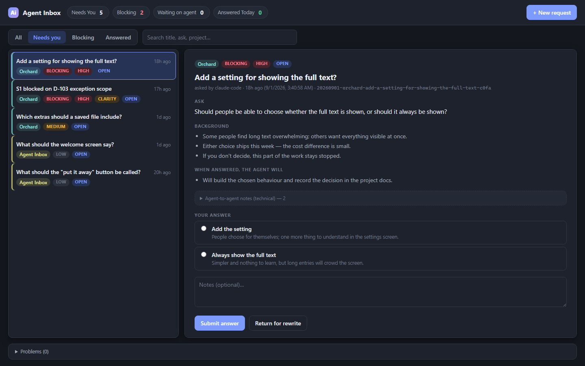
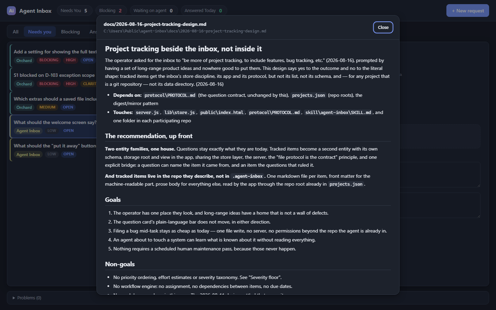

# Agent Inbox

**A shared to-do list of questions your coding agents need you to answer.**

When you have several coding agents working across several repositories, they keep hitting
decisions only you can make: what should this be called, which of these two behaviours do we
want, is this worth the cost. Today each one asks in its own terminal, and the question is
only visible while you happen to be looking at that terminal. Ask three agents to work and
you have three places to watch — and an agent that stops on a question you never saw is an
agent doing nothing for an hour.

Agent Inbox gives them one place to ask and you one place to answer. Agents file questions as
JSON files; you answer them in a local web app; the answers are written back where the agents
will look for them. Nothing leaves your machine.



## Try it

```bash
node demo.js
```

That seeds a throwaway inbox with sample questions, starts the server, and opens it. Your own
data is untouched, and the temporary store is deleted when you stop it with Ctrl+C. No install
step, no dependencies — the whole project is Node's standard library and one HTML file.

Requires Node 20 or newer. Three things are worth trying once it opens:

- **Answer the top question** and watch it move to the Answered tab.
- **Open "S1 blocked on D-103 exception scope."** It is written in agent jargon and carries a
  `CLARITY` badge because of it. Hit **Return for rewrite** to bounce it back to the agent.
- **Look at `answers/orchard.md`** in the store it names on startup. That generated file is
  what the agent reads to learn what you decided.

## The idea

**The file protocol is the contract; the app is only a viewer.**

An agent participates using nothing but the filesystem. To ask, it writes one JSON file into
`~/.agent-inbox/requests/`. To find out what you said, it reads that file again, or reads the
generated per-project digest at `~/.agent-inbox/answers/<project>.md`. The server does not
need to be running for either. Nothing has to be installed in the agent's environment, and
agents that know nothing about each other can all use it.

That constraint is what makes it work across tools. Claude Code, Codex, and anything else that
can write a file are all first-class, because writing a file is the entire integration.

```
~/.agent-inbox/
  PROTOCOL.md            the contract agents read
  projects.json          registry: slug -> { name, repo, mirror? }
  requests/<id>.json     one file per question; the answer is written into the same file
  answers/<slug>.md      generated digest of settled questions, per project
```

### Questions have to be answerable

The interesting constraint is not the file format, it is the writing bar. A question is only
useful if you can answer it without reloading the whole project into your head, so the
protocol makes that a rule rather than a hope:

> Could a person who has never seen the project answer this in 60 seconds, using only the text
> on the card?

File paths, symbol names, ticket IDs and section references are **banned** from every field
you read, and quarantined in a `technical_context` field the app keeps collapsed. The app
lints for violations and flags them, and you can bounce a bad question back to its author with
one click — it returns to the agent with a reason, and the agent rewrites it and re-files.

This is the part most worth stealing. An agent asked to write for a reader who has never seen
the codebase asks a visibly better question, and the failure mode it prevents — a question
technically answerable but practically unanswerable, so it sits there — is the one that
actually kills this kind of tool.

### Reading what a question refers to

When a question mentions a markdown file in its project's repository, the app turns it into a
link and renders the document in place. Useful when the answer depends on a design doc you
half-remember, and it means the inbox never has to shell out to an editor to be useful.



Rendering is a small parser in [`public/markdown.js`](public/markdown.js) with no dependencies.
If you would rather open documents in your own editor, set `AGENT_INBOX_OPEN_CMD` and an
**Open in editor** button appears. It is unset by default, and with it unset the server never
launches a process at all.

## Install it for real

```bash
git clone https://github.com/joooooooooooe/agent-inbox
cd agent-inbox
node setup.js
```

`setup.js` is idempotent and safe to re-run. It creates the data store at `~/.agent-inbox`,
writes `PROTOCOL.md` there with this machine's paths filled in, and installs a Claude skill at
`~/.claude/skills/agent-inbox/` so Claude Code picks it up in every project on the machine.

Then start it:

```bash
npm start
```

and open <http://127.0.0.1:7717>. On Windows, `start-inbox.cmd` starts the server and opens the
browser in one step; on macOS and Linux, `./start-inbox.sh` does the same.

| Variable | Default | Purpose |
|---|---|---|
| `AGENT_INBOX_PORT` | `7717` | Listen port |
| `AGENT_INBOX_DATA_DIR` | `~/.agent-inbox` | Where the data store lives |
| `AGENT_INBOX_OPEN_CMD` | unset | A program to open documents in. Unset means the server spawns nothing. |

### Register your projects

Edit `~/.agent-inbox/projects.json`:

```json
{
  "schema_version": 1,
  "projects": {
    "myproject": {
      "name": "MyProject",
      "repo": "/home/you/code/myproject",
      "mirror": "dev/agent-answers.md"
    }
  }
}
```

`name` is the display name. `repo` is where the project lives, which is what lets the app
resolve documents a question links to. `mirror` is optional: a path inside the repo where the
answers digest is copied after every answer, so agents find decisions without leaving their own
working directory. A missing repo or a bad mirror path never breaks answering — it shows up as
a warning.

Questions from unregistered projects still work; registering only adds the display name,
mirroring, and document links.

### Point your agents at it

Claude Code picks up the skill automatically after `setup.js`. For anything else, paste the
snippet in section 5 of `~/.agent-inbox/PROTOCOL.md` into the repo's `AGENTS.md` or
`CLAUDE.md`.

## Security

It is a local web server that reads and writes files, so the boundaries are worth stating:

- **Binds `127.0.0.1` only**, and every `/api/` route — reads included — requires a `Host`
  header of `127.0.0.1:<port>` or `localhost:<port>`. Binding loopback alone would not be
  enough: DNS rebinding can make a hostile page same-origin with the inbox, and the `Host`
  check is what a browser will not let that page forge. No CORS headers are ever sent.
- **Documents are resolved inside the requesting project's own repository**, must be markdown,
  must already exist, and are size-capped. A path that escapes the repo is refused, including
  the case of a sibling directory whose name merely starts with the repo's name.
- **No process is launched** unless `AGENT_INBOX_OPEN_CMD` is set. When it is, the file path is
  passed as a single argument and never through a shell.
- **Nothing is rendered as HTML.** Agent-authored text and document contents alike become DOM
  text nodes; the markdown parser emits data, never markup, so a document cannot inject script.
- Request bodies are capped at 1 MB, request ids are validated before any filesystem access,
  and every write is atomic (write to a temporary file, then rename).

## Tests

```bash
npm test
```

No dependencies, no runner to install — `node --test` over `test/`. The suite covers the store
layer, the HTTP layer (host gate, content-type gate, body cap, traversal gate, routes), the
document resolver, and the markdown parser, all against temporary directories. It never touches
your real data store.

## Auto-start on login (optional)

<details>
<summary>Windows — Task Scheduler</summary>

1. **Task Scheduler** → *Create Task…*
2. **General:** name it `Agent Inbox`; select *Run only when user is logged on*.
3. **Triggers:** *New…* → *At log on* → your user.
4. **Actions:** *New…* → *Start a program*:
   - Program/script: `C:\Program Files\nodejs\node.exe`
   - Arguments: `server.js`
   - Start in: your clone folder
5. **Conditions:** untick *Start the task only if the computer is on AC power*.

</details>

<details>
<summary>macOS — launchd, or Linux — systemd</summary>

On macOS, a `~/Library/LaunchAgents/agent-inbox.plist` running
`/usr/local/bin/node /path/to/agent-inbox/server.js` with `RunAtLoad`. On Linux, a systemd user
unit doing the same with `WantedBy=default.target`.

</details>

## HTTP API

Localhost only. POSTs require `Content-Type: application/json`.

| Route | Method | Purpose |
|---|---|---|
| `/api/state` | GET | `{ projects, requests, invalid }` — read fresh from disk every call |
| `/api/requests` | POST | Create a question |
| `/api/requests/<id>/answer` | POST | `{ value, notes?, force? }` — answer it; `409` if already settled unless `force` |
| `/api/requests/<id>/status` | POST | `{ status, superseded_by?, returned_reason? }` — reopen, withdraw, supersede, or return for rewrite |
| `/api/requests/<id>/archive` | POST | File a settled question away |
| `/api/file` | POST | `{ id, path }` — read a markdown document from that question's repo |
| `/api/open` | POST | `{ id, path }` — hand it to `AGENT_INBOX_OPEN_CMD`; `400` if unset |

## How this was built

Every line of this was written by Claude, working from a spec it wrote and a plan a second
agent produced from that spec. Both are in `docs/`, unedited, alongside the design arguments
for later changes:

- [`docs/2026-08-07-agent-inbox-design.md`](docs/2026-08-07-agent-inbox-design.md) — the
  original design spec
- [`docs/2026-08-07-implementation-plan.md`](docs/2026-08-07-implementation-plan.md) — the
  implementation plan, handed verbatim to the builder
- [`docs/2026-08-16-project-tracking-design.md`](docs/2026-08-16-project-tracking-design.md) —
  a proposal to extend the inbox into project tracking, which argues *against* the shape it was
  asked for and recommends a different one

The third is the most interesting, and the reason the inbox exists: the question of whether to
merge tracked work into the questions list is exactly the kind of decision that needs a human,
and exactly the kind that gets lost in a terminal.

## License

MIT — see [LICENSE](LICENSE).
